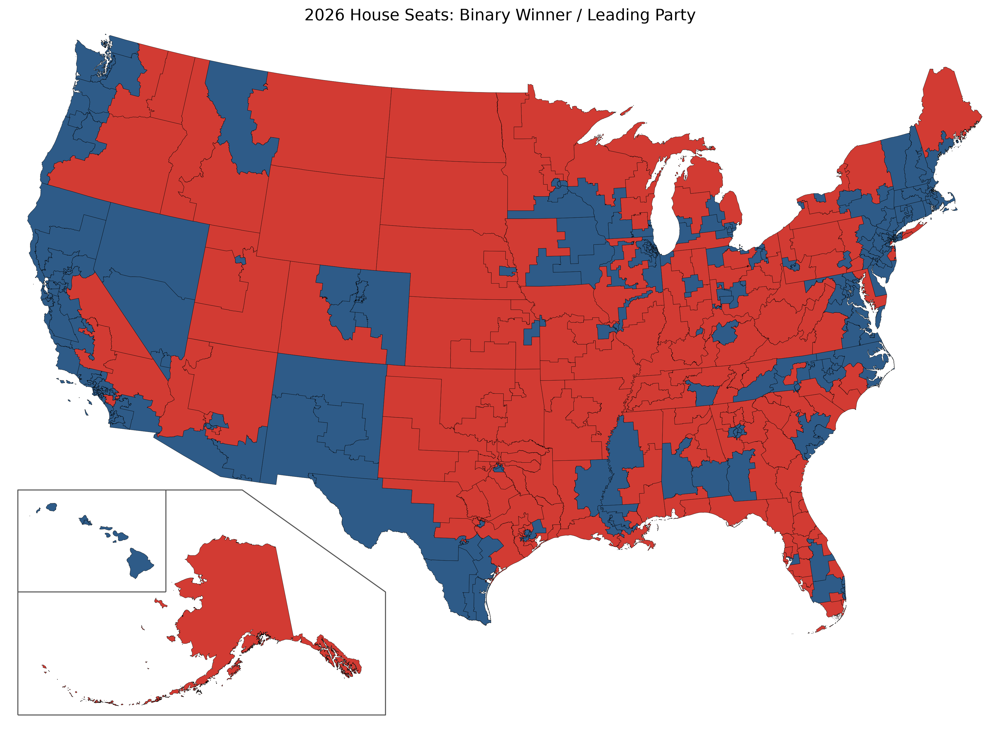
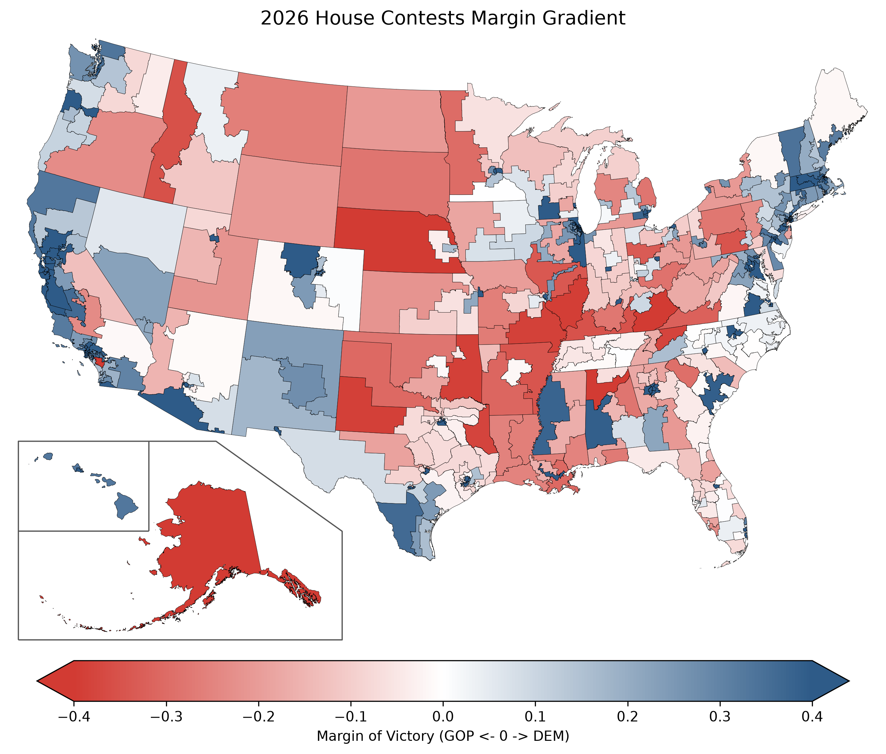
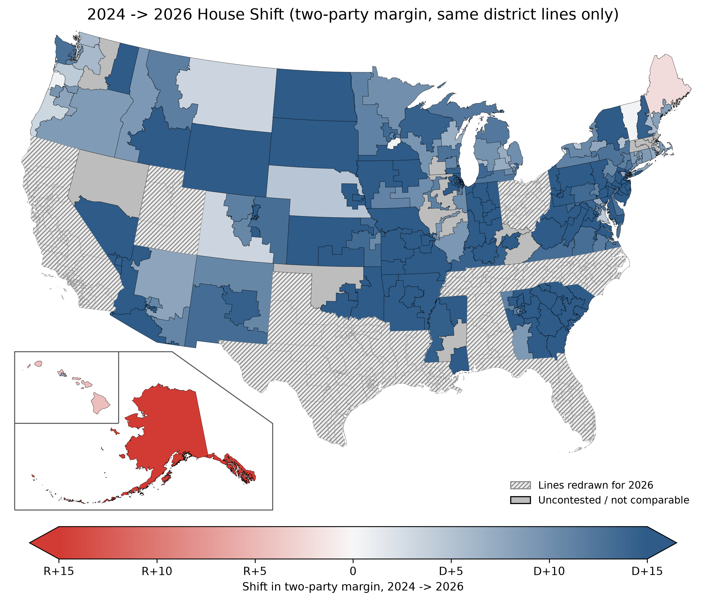
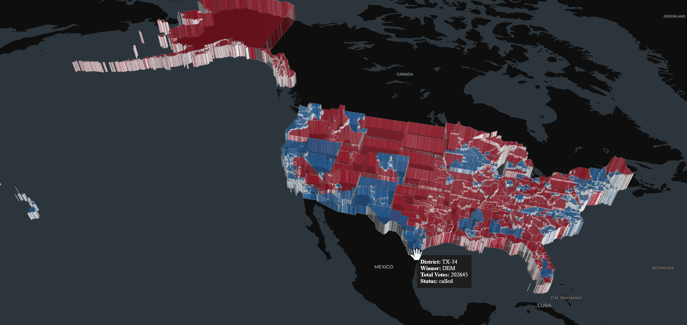

# 🗳️ 2026 U.S. House Election Dashboard & Spatial Analytics Pipeline

A three-component containerized data pipeline and interactive analytics dashboard for tracking, analyzing, and visualizing the 2026 U.S. House of Representatives elections in real time. 

This project integrates concurrent asynchronous API polling (2026 results plus a 2024 baseline), spatial geometry transformations (2026 district lines, and Alaska/Hawaii repositioned into a classic "Albers USA" inset), an exploratory Jupyter analysis environment, and a multi-tab Streamlit dashboard.

The data in this application is current as of 2026-11-09 - the last time a data collection was performed before checking the work into GitHub.

---

## 🏗️ Architecture Overview

The application is structured into three primary components running inside a unified Docker container environment:

```text
election_project/
├── _1_data_collector.py               # Asynchronous API polling & Spatial ETL pipeline
├── _2_notebook.ipynb                  # Exploratory analysis & static map rendering
├── _3_app.py                          # Streamlit web application & interactive visualizations
├── data/                              # Output directory for datasets
│   ├── election_2026_master.geojson   # 2026 results + 2024 baseline + shift, on 2026 district lines
│   └── results_2024.csv               # Cached 2024 House results (fetched once)
├── images/                            # Rendered static plot outputs & README assets
│   ├── 2026-3D-turnout-map.html
│   ├── 2026-3D-turnout-map.png
│   ├── 2026-Binary-Blue-Red-Color-Map.png
│   ├── 2026-Blue-Red-Gradient-Map.png
│   └── 2026-Shift-From-2024-Map.png
├── .dockerignore                      # Keeps venv/, .git/ and large artifacts out of the image
├── .gitignore                         # Ignore files when syncing with GitHub
├── Dockerfile                         # Geospatial-enabled Python container build file
├── docker-compose.yml                 # Multi-service orchestration config
├── requirements.txt                   # Python dependency specifications
└── README.md                          # This file
```
---

## 🛠️ Requirements & Setup

### Local Development Setup (Without Docker)

If you wish to run the python scripts directly on your local system:

1. Clone the repository:  
```bash
git clone https://github.com/cesinco/2026-midterm-elections.git
cd 2026-midterm-elections
```

2. Create a virtual environment & install dependencies:  
```bash
python -m venv venv
source venv/bin/activate 
# On Windows:
# venv\Scripts\activate
pip install -r requirements.txt
```

3. Run the data collector (from the project root):  
```bash
python _1_data_collector.py
```
The first run also fetches the 2024 baseline results and caches them in `data/results_2024.csv`; later runs reuse the cache. Each fetch reports how many of the 435 races it retrieved.

4. Render the static and 3D maps by running all cells in  
```
_2_notebook.ipynb
```

5. Launch Streamlit locally:  
```bash
streamlit run _3_app.py
```

---

## 🐳 Docker Deployment

The project is fully containerized using a geospatial-ready Linux image (python:3.11-slim with compiled GDAL and GEOS dependencies).

### Running with Docker Compose (Recommended)

To launch both the Streamlit Dashboard and the Jupyter Notebook Server simultaneously:

```bash
docker compose up --build -d
```

Service Endpoints:

🌐 Streamlit Web Dashboard: [http://localhost:8501](http://localhost:8501)

📓 Jupyter Notebook Workspace: [http://localhost:8888](http://localhost:8888)

## 🔄 Updating Data Inside the Docker Container

The application comes pre-packaged with the latest pre-fetched dataset (`data/election_2026_master.geojson`), allowing the dashboard to render instantly upon launch without an initial API call. 

If you wish to pull live election updates from the CNN API and re-process the spatial geometries, you can trigger the data collector using either method below:

### Method 1: Via the Streamlit Web Interface (Recommended)
1. Open the dashboard in your browser ([http://localhost:8501](http://localhost:8501)).
2. Locate the **"Sync / Refresh Data"** button in the sidebar.
3. Click to execute the collector script in the background. The maps and metrics will automatically update once the fetch completes.

### Method 2: Via Command Line (`docker exec`)

If you want to execute the collector directly from your terminal while the containers are running:

Using Docker Compose:  
```bash
docker compose exec streamlit-dashboard python _1_data_collector.py
```

The docker image has also been published to Docker Hub at:  

[https://hub.docker.com/r/cesinco/2026-midterm-elections-app](https://hub.docker.com/r/cesinco/2026-midterm-elections-app)

---

## 📊 Visual Previews

The included Jupyter notebook generates 4 visualizations. The static maps show Alaska and Hawaii in a lower-left inset, rescaled and repositioned as in standard U.S. reference maps.

1. **Winner / leading party** in each district.

   

2. **Margin of victory** as a red-white-blue gradient.

   

3. **Shift from 2024 to 2026**: change in each district's two-party margin, (D − R) / (D + R). Blue = moved toward Democrats, red = toward Republicans, white = little change; colours saturate at a 15-point swing.

   

4. A dynamic 3D map that can be zoomed and rotated in its own web page at [./images/2026-3D-turnout-map.html](./images/2026-3D-turnout-map.html)

A screenshot taken from that web page:  



---

## 📐 Data & Methodology Notes

- **Results:** CNN's election results API, per district, for 2026 (`2026-HG-{state}-{district}`) and 2024 (`2024-HG-{state}-{district}`).
- **District boundaries:** the 2026 election elects the 120th Congress. Nine states redrew their districts for 2026 (AL, CA, FL, LA, NC, OH, TN, TX, UT), so their districts come from the Census Bureau's 2026 TIGER/Line `cd120` files, clipped to the shoreline. All other states use the Census 119th Congress cartographic boundary file, whose lines are unchanged for 2026. Missouri passed a new map that was not allowed for 2026, so it keeps its 2024 lines.
- **Shift map:** a district-level 2024 → 2026 shift is only meaningful where the district covers the same area in both years. Districts in the nine redrawn states (173 seats) are therefore **hatched** rather than coloured. Districts where either major party had no candidate (or no reported votes) in either year are shown in **gray**, since a two-party margin can't be computed.
- **Two-party margin** ignores third-party votes so that a minor candidate appearing in one year but not the other doesn't register as a shift. The margin-of-victory map (2) uses total votes as its denominator.
- **Uncalled races** are coloured by the current leader.

---

## 📜 License

Distributed under the MIT License.